# PriorityCare (MEDI-DISPATCH AI) — Complete Implementation Plan

**Document Version:** 1.0.0-RELEASE  
**Document Status:** Approved Engineering Roadmap Baseline  
**Project:** PriorityCare (INTELLATHON '26 — Team JARVIS)  
**Engineering Leads:** Senior Technical Project Manager, Software Architect & Engineering Lead  
**Cross-References:** Accompanies [PRD.md](file:///c:/Users/PURUSOUTHANAN/OneDrive/Desktop/priorcare/PRD.md) and [SYSTEM_ARCHITECTURE.md](file:///c:/Users/PURUSOUTHANAN/OneDrive/Desktop/priorcare/SYSTEM_ARCHITECTURE.md)  

---

## 1. Executive Implementation Strategy

PriorityCare is an emergency dispatch decision-support platform designed to transition 112/108 call-taking operations from slow, manual, proximity-based dispatch into an **automated, capability-aware copilot**.

To successfully deliver a battle-tested, demo-ready application within hackathon time constraints, the team will execute a **Contract-First Modular Monolith Strategy**:
1. **Zero-Wait Parallelization:** Development will not proceed sequentially. By locking the common API schemas, enums, and JSON payloads in Phase 0, Person 4 (Frontend) can immediately build the complete React UI using mock fixtures while Person 1, Person 2, and Person 3 implement database, decision, and routing engines.
2. **Deterministic Algorithm Foundation:** The core engines (Dynamic Questions, Priority Triage, Duplicate Detection, and Dijkstra Routing) are deterministic, auditable, and testable without external black-box cloud APIs.
3. **Simulated Real-World Telemetry:** Because live 112 CAD feeds and commercial traffic APIs are unavailable, the system will use a pre-seeded regional database (Perambalur / Trichy district) and a deterministic synthetic congestion model.
4. **Single Integration Gatekeeper:** Person 3 exclusively controls merges into the `master` branch, enforcing contract integrity and test validation on every pull request.

```
┌────────────────────────────────────────────────────────────────────────┐
│                        PARALLEL TRACK EXECUTION                        │
├─────────────────┬────────────────────────────┬─────────────────────────┤
│ Track A (AI/DB) │ Person 1: Allocation, OSM  │ Independent AI & DB     │
│                 │ Routing, Schema & DDL      │ service development     │
├─────────────────┼────────────────────────────┼─────────────────────────┤
│ Track B (Logic) │ Person 2: Question Trees,  │ Generates test fixtures │
│                 │ Scoring Formulas & Rubrics │ & clinical test cases   │
├─────────────────┼────────────────────────────┼─────────────────────────┤
│ Track C (Core)  │ Person 3: Question Engine, │ Builds FastAPI services │
│                 │ Priority, Dedup & Gateway  │ & maintains master      │
├─────────────────┼────────────────────────────┼─────────────────────────┤
│ Track D (UI/UX) │ Person 4: React Dashboard, │ Builds complete UI      │
│                 │ Leaflet OSM Map & Cockpit  │ against JSON mocks      │
└─────────────────┴────────────────────────────┴─────────────────────────┘
```

---

## 2. Team Roles and Ownership

The implementation plan is structured around four specialized roles with explicit, non-overlapping modular responsibilities:

| Role | Teammate | Core Focus Area | Primary Code & Artifact Ownership |
| :--- | :--- | :--- | :--- |
| **Person 1** | **Teammate A (Lead / User)** | **AI, Routing & Database Architecture** | • `app/services/allocation_engine.py`<br/>• `app/services/routing_engine.py` (Dijkstra on OSM)<br/>• `db/init.sql` & SQLAlchemy models (`app/models/`)<br/>• `PRD.md` & `SYSTEM_ARCHITECTURE.md` |
| **Person 2** | **Teammate B** | **Research & Decision Logic** | • `docs/TRIAGE_SPEC.md` (Clinical scoring rubric)<br/>• `docs/QUESTION_BANK.json` (Branching tree)<br/>• Scenario test cases & tie-breaking rules |
| **Person 3** | **Teammate C** | **Algorithm Implementation & Integration** | • `app/services/question_engine.py`<br/>• `app/services/priority_engine.py`<br/>• `app/services/dedup_engine.py`<br/>• `app/api/v1/` routes & master branch gateway |
| **Person 4** | **Teammate D** | **UI/UX & Frontend Development** | • React 18 / Vite SPA (`frontend/src/`)<br/>• Operator Cockpit (Queue, Question Wizard, Map)<br/>• Leaflet / OSM route visualization<br/>• Mock client & FastAPI API integration |

---

## 3. Dependency-Aware Roadmap (Phases 0 – 6)

```mermaid
gantt
    title PriorityCare Dependency-Aware Implementation Roadmap
    dateFormat  X
    axisFormat  Phase %X

    section Phase 0: Alignment
    Contract Freeze & Schema Lock        :p0_1, 0, 1
    Repository Scaffold & Branch Setup   :p0_2, 0, 1

    section Phase 1: Foundation
    PostgreSQL & Docker Setup            :p1_1, 1, 2
    FastAPI App & Pydantic Schemas       :p1_2, 1, 2
    React Project Setup & Mock API Client:p1_3, 1, 2

    section Phase 2: Parallel Work
    Track A: Allocation & Dijkstra Routing:p2_1, 2, 4
    Track B: Question Trees & Triage Spec :p2_2, 2, 3
    Track C: Core Question & Priority Eng :p2_3, 3, 5
    Track D: React Dashboard & OSM Map UI :p2_4, 2, 5

    section Phase 3: Backend Integration
    DB Integration & Dedup Implementation:p3_1, 5, 7
    Dispatch Confirmation & State Machine:p3_2, 6, 8

    section Phase 4: Frontend Connect
    Connect React to Live FastAPI Endpoints:p4_1, 7, 9
    Handle Stale Data, Overrides & Errors :p4_2, 8, 10

    section Phase 5: E2E Validation
    Simulate 12 Emergency Scenarios      :p5_1, 10, 11
    Audit Log & Concurrency Verification :p5_2, 10, 11

    section Phase 6: Demo Polish
    Preload Seed Data & Demo Script      :p6_1, 11, 12
    Presentation Slides & Pitch Polish   :p6_2, 11, 12
```



---

## 4. Master Task Matrix

*Priority Scale: **P0** = Essential MVP deliverable; **P1** = High-value core refinement; **P2** = Optional enhancement.*

| Task ID | Phase | Description | Owner | Support | Dependencies | Target Files / Modules | Deliverable | Acceptance Criteria | Priority | Status |
| :--- | :---: | :--- | :---: | :---: | :---: | :--- | :--- | :--- | :---: | :---: |
| **TSK-P0-01** | 0 | Schema & Contract Freeze | Person 1 | Person 3 | `PRD.md` | `app/schemas/domain.py` | Validated Pydantic models | All 8 core entities and enums locked | **P0** | **Done** |
| **TSK-P0-02** | 0 | Git Repo & Branch Rules | Person 3 | Person 1 | None | `.github/`, `.gitignore` | Branch protection on master | Feature branch strategy enforced | **P0** | **Done** |
| **TSK-P1-01** | 1 | Database DDL & Docker Compose | Person 1 | Person 3 | TSK-P0-01 | `db/init.sql`, `docker-compose.yml` | Running PostgreSQL container | Schema loads cleanly with foreign keys | **P0** | Not Started |
| **TSK-P1-02** | 1 | FastAPI Scaffold & CORS | Person 3 | Person 1 | TSK-P0-01 | `app/main.py`, `app/core/config.py` | FastAPI server with `/health` | Server boots and returns 200 OK | **P0** | Not Started |
| **TSK-P1-03** | 1 | React Scaffold & Leaflet Setup | Person 4 | Person 3 | None | `frontend/package.json`, `App.tsx` | Running React development server | Boots with 3-pane layout shell | **P0** | Not Started |
| **TSK-P1-04** | 1 | Mock JSON Fixtures for UI | Person 4 | Person 1 | TSK-P0-01 | `frontend/src/api/mockData.ts` | Static JSON responses matching PRD | UI renders mock queue, questions & map | **P0** | Not Started |
| **TSK-P2-01** | 2 | Clinical Triage Spec & Rules | Person 2 | Person 3 | TSK-P0-01 | `docs/TRIAGE_SPEC.md` | Triage scoring rubric & P1 triggers | Formulas documented with test examples | **P0** | Not Started |
| **TSK-P2-02** | 2 | Dynamic Question Bank JSON | Person 2 | Person 3 | TSK-P2-01 | `docs/QUESTION_BANK.json` | Decision tree for 5 vitals + RTA/Card | Valid JSON parsing into QuestionSchema | **P0** | Not Started |
| **TSK-P2-03** | 2 | Question Engine Service | Person 3 | Person 2 | TSK-P2-02 | `app/services/question_engine.py` | Dynamic branch evaluator service | Delivers next questions based on answers | **P0** | Not Started |
| **TSK-P2-04** | 2 | Priority Scoring Service | Person 3 | Person 2 | TSK-P2-01 | `app/services/priority_engine.py` | Urgency scoring calculation service | Absent breathing $\to$ P1 (<10s) verified | **P0** | Not Started |
| **TSK-P2-05** | 2 | OSM Road Graph Loader & Dijkstra | Person 1 | Person 3 | TSK-P0-01 | `app/services/routing_engine.py` | In-memory NetworkX routing engine | Dijkstra computes shortest path in <50ms | **P0** | Not Started |
| **TSK-P2-06** | 2 | Ambulance Allocation Engine | Person 1 | Person 3 | TSK-P0-01 | `app/services/allocation_engine.py` | Suitability & ETA ranking service | Filters ALS for P1 and ranks top 3 units | **P0** | Not Started |
| **TSK-P2-07** | 2 | React Call Intake Wizard Component | Person 4 | Person 2 | TSK-P1-04 | `frontend/src/components/CallIntake.tsx` | Step-by-step 5-vitals question UI | Displays dynamic questions & handles P1 alert | **P0** | Not Started |
| **TSK-P2-08** | 2 | React Live Priority Queue Component| Person 4 | Person 3 | TSK-P1-04 | `frontend/src/components/IncidentQueue.tsx`| Table view sorted by P1/P2/P3 | Cards dynamically color-coded by tier | **P0** | Not Started |
| **TSK-P2-09** | 2 | React Leaflet Route Map Component | Person 4 | Person 1 | TSK-P1-04 | `frontend/src/components/MapView.tsx` | Map showing incidents, units & routes | Renders GeoJSON LineStrings on OSM | **P0** | Not Started |
| **TSK-P3-01** | 3 | Spatial-Temporal Dedup Engine | Person 3 | Person 1 | TSK-P1-01 | `app/services/dedup_engine.py` | Multi-factor clustering service | Clusters calls $\le 500$m & $\le 20$m | **P0** | Not Started |
| **TSK-P3-02** | 3 | Call Intake & Dedup API Routes | Person 3 | Person 1 | TSK-P3-01 | `app/api/v1/calls.py` | Endpoints: `/calls/intake`, `/answers` | Auto-detects duplicates and serves vitals | **P0** | Not Started |
| **TSK-P3-03** | 3 | Active Incident Queue API Route | Person 3 | Person 1 | TSK-P1-01 | `app/api/v1/incidents.py` | Endpoint: `GET /incidents?status=ACTIVE` | Returns SQL-sorted priority queue | **P0** | Not Started |
| **TSK-P3-04** | 3 | Recommendations API Route | Person 1 | Person 3 | TSK-P2-05 | `app/api/v1/incidents.py` | Endpoint: `GET /{id}/recommendations` | Returns top 3 ambulance + hospital paths | **P0** | Not Started |
| **TSK-P3-05** | 3 | Dispatch Execution & Audit Route | Person 1 | Person 3 | TSK-P1-01 | `app/api/v1/dispatch.py` | Endpoint: `POST /dispatch/confirm` | Atomic status updates & audit trail | **P0** | Not Started |
| **TSK-P3-06** | 3 | Demo Database Seed Script | Person 1 | Person 4 | TSK-P1-01 | `db/seed_demo_data.py` | Script seeding ambulances & hospitals | Seeds 10 ambulances & 5 hospitals | **P0** | Not Started |
| **TSK-P4-01** | 4 | Connect React to Live API Endpoints| Person 4 | Person 3 | TSK-P3-02 | `frontend/src/api/client.ts` | Axios client communicating with backend | Replaces mock fixtures with live API calls | **P0** | Not Started |
| **TSK-P4-02** | 4 | Real-Time Queue Auto-Refresh | Person 4 | Person 3 | TSK-P4-01 | `frontend/src/components/IncidentQueue.tsx`| Polling loop (every 3s) or refetch trigger | New calls immediately appear in queue | **P0** | Not Started |
| **TSK-P4-03** | 4 | Dispatch Confirmation & Toast Alerts | Person 4 | Person 1 | TSK-P3-05 | `frontend/src/components/RecCard.tsx` | Confirm button triggers dispatch API | Updates unit to `EN_ROUTE_SCENE` | **P0** | Not Started |
| **TSK-P4-04** | 4 | Manual Override Modal with Reason | Person 4 | Person 1 | TSK-P3-05 | `frontend/src/components/OverrideModal.tsx`| Modal capturing mandatory override reason | Submits override payload to backend | **P1** | Not Started |
| **TSK-P5-01** | 5 | End-to-End Automated Test Suite | Person 3 | Person 1 | TSK-P4-01 | `tests/test_e2e_workflow.py` | Pytest simulating full call-to-dispatch | All 12 operational scenarios pass | **P0** | Not Started |
| **TSK-P5-02** | 5 | Concurrency & Duplicate Merge Test | Person 3 | Person 2 | TSK-P3-01 | `tests/test_dedup_merge.py` | Test verifying casualty count accumulation | Call 1 (1 victim) + Call 2 (2 victims) $\to$ 2 | **P0** | Not Started |
| **TSK-P5-03** | 5 | Route Fallback on Map Error Test | Person 1 | Person 3 | TSK-P2-05 | `tests/test_routing_fallback.py` | Test verifying Haversine Euclidean fallback | Returns estimated route on broken graph | **P1** | Not Started |
| **TSK-P6-01** | 6 | 5-Minute Hackathon Demo Script | Person 1 | Person 2 | All | `docs/DEMO_SCRIPT.md` | Predictable 3-call judge presentation script | Step-by-step walkthrough documented | **P0** | Not Started |
| **TSK-P6-02** | 6 | Synthetic Traffic Toggle Switch | Person 1 | Person 4 | TSK-P2-05 | `frontend/src/components/TrafficToggle.tsx`| UI switch simulating peak-hour congestion | Live route switches when traffic toggled | **P1** | Not Started |
| **TSK-P6-03** | 6 | Docker One-Click Launch Script | Person 1 | Person 3 | TSK-P1-01 | `docker-compose.yml`, `README.md` | `docker compose up` starts full stack | System initializes in $<90$ seconds | **P0** | Not Started |

---

## 5. Parallel Work Analysis and Critical Path

### 5.1 Immediate Work (Unblocked)
The following tasks can begin in parallel immediately:
* **Person 1:** Build PostgreSQL DDL (`db/init.sql`) and Dijkstra routing engine using NetworkX and sample OSM coordinates.
* **Person 2:** Draft the clinical scoring rubric in `docs/TRIAGE_SPEC.md` and complete `docs/QUESTION_BANK.json`.
* **Person 3:** Initialize FastAPI backend skeleton (`app/main.py`) with Pydantic schemas and test endpoints.
* **Person 4:** Build the React 3-pane layout shell with Leaflet map and dynamic question form using mock JSON fixtures.

### 5.2 Dependency Handoff Gates
1. **Gate 1 (Research to Engine):** Person 3 cannot complete `app/services/priority_engine.py` until Person 2 delivers `docs/TRIAGE_SPEC.md` (TSK-P2-01).
2. **Gate 2 (Routing to API):** Person 3 cannot finalize `GET /{id}/recommendations` until Person 1 delivers `app/services/routing_engine.py` (TSK-P2-05).
3. **Gate 3 (Backend to Live UI):** Person 4 cannot disconnect mock fixtures until Person 3 verifies live API routes on the `master` branch (TSK-P4-01).

---

## 6. GitHub Branching and Integration Protocol

To prevent merge chaos and broken builds on the hackathon repository:

```
                  [ master ] (Protected Branch)
                       │
         ┌─────────────┼─────────────┬─────────────┐
         ▼             ▼             ▼             ▼
      feature/      feature/      feature/      feature/
      ai-routing    triage-logic  backend-core  react-ui
     (Person 1)    (Person 2)    (Person 3)    (Person 4)
```

### Git Rules:
1. **Direct Pushes Forbidden:** Pushing directly to `master` is strictly prohibited. All code merges through Pull Requests.
2. **Master Branch Gatekeeper:** **Person 3** owns the `master` branch. Person 3 alone is authorized to approve and merge PRs.
3. **PR Pre-Requisites:** Before opening a PR into `master`, the contributor must:
   * Rebase on current `master` (`git pull --rebase origin master`).
   * Verify all automated tests pass (`pytest tests/`).
   * Ensure zero modifications to locked schemas in `app/schemas/domain.py` without team consensus.
4. **Emergency Hotfix Protocol:** If an urgent fix is needed during integration, Person 3 and the respective module owner conduct a synchronous peer-coding session and push a single signed commit.

---

## 7. Testing and Verification Strategy

| Test Layer | Framework | Target Scope | Acceptance Criteria |
| :--- | :--- | :--- | :--- |
| **Unit Tests** | `pytest` | Triage formula, question selection, duplicate radius logic | • Absent breathing triggers P1 in $<10$ms.<br/>• 500m radius clusters duplicate calls.<br/>• Casualties never decrease on merge. |
| **Contract Tests** | `pytest-mock` | Pydantic V2 schemas vs FastAPI OpenAPI outputs | Request/Response payloads match `PRD.md` with zero missing fields. |
| **Routing Tests** | `pytest` | Dijkstra path calculation on OSM graph | • Shortest path calculated in $<50$ms.<br/>• Suitable Hospital B chosen over closer unsuitable Hospital A. |
| **Frontend State Tests** | React Testing Library | UI states (Loading, Error, Instant P1 Alert, Map render) | • Red alert banner displays instantly on P1.<br/>• Queue sorts P1 above P2.<br/>• Map renders route GeoJSON correctly. |
| **End-to-End Simulation** | Python test runner | Simulated 3-call emergency surge | Full lifecycle executes: Call $\to$ Triage $\to$ Dedup $\to$ Alloc $\to$ Route $\to$ Confirm $\to$ Audit Log. |

---

## 8. Five-Minute Hackathon Demo Script (INTELLATHON '26)

The demonstration is structured to prove technical superiority and clinical safety to judges in exactly 5 minutes:

```
[ Minute 0:00 - 0:45 ] THE PROBLEM (Pitch & Dashboard Overview)
• Present the high-stress operator cockpit (3-pane layout).
• Highlight current dispatch gaps: 112 call overload, duplicate confusion, and blind nearest-hospital routing.

[ Minute 0:45 - 2:00 ] CALL 1 & CALL 2 (Multi-Factor Deduplication & Casualty Invariant)
• Caller 1 reports a collision at Samayapuram Toll Plaza (1 injured). Operator enters details.
• Call 2 arrives 90 seconds later: bystander reports the same crash but notes 2 injured people trapped.
• SYSTEM ACTION: PriorityCare flags HIGH_MATCH (94% confidence, 35m distance). 
• SHOWCASE: Operator clicks "Merge". The incident casualty count automatically updates to 2 without creating a duplicate ghost incident.

[ Minute 2:00 - 3:15 ] CALL 3 (Instant P1 Fail-Fast Escalation)
• Call 3 arrives: an elderly citizen collapsing with severe chest pain and gasping.
• Operator enters: "Consciousness: Unresponsive", "Breathing: Absent".
• SYSTEM ACTION: Instant P1 Escalation triggers immediately on Question 2!
• SHOWCASE: System bypasses remaining questions, sounds a visual alert, and moves Incident #102 to Rank 1 of the queue.

[ Minute 3:15 - 4:15 ] SUITABILITY-FIRST ALLOCATION & DIJKSTRA ROUTING
• Open Incident #101 (2 trapped trauma casualties).
• SHOWCASE: System selects an ALS Ambulance (with trauma extrication kit) over a closer BLS transport unit.
• SHOWCASE: Dijkstra calculates route to Hospital B (15 mins away with active Trauma ICU) instead of Clinic A (10 mins away without trauma facilities).
• Operator confirms dispatch. State updates to "DISPATCHED", ambulance moves on OSM map.

[ Minute 4:15 - 5:00 ] METRICS & IMPACT
• Display the analytics panel: Call handling time reduced by 45%, zero false merges, optimal specialized hospital delivery.
• Reiterate alignment with UN SDGs 3, 9, and 11.
```

---

## 9. Risk Register and Mitigation Plans

| Risk ID | Risk Description | Severity | Likelihood | Mitigation Strategy |
| :---: | :--- | :---: | :---: | :--- |
| **RSK-01** | **Over-Aggressive Duplicate Merging:** Merging two independent accidents occurring near each other. | **Critical** | Low | Require explicit operator review modal for any match with confidence between 50% and 85%. Never auto-merge without operator override for borderline cases. |
| **RSK-02** | **OSM Road Graph Loading Latency:** Downloading live OSM data during live demo fails due to slow hackathon WiFi. | **High** | High | **Pre-load and cache the regional road network graph in a local binary file** (`data/road_graph_perambalur.gpickle`). Zero live internet calls required during demo. |
| **RSK-03** | **Frontend-Backend Integration Drift:** Teammate D builds React UI with different JSON keys than FastAPI. | **High** | Medium | `PRD.md` and `app/schemas/domain.py` are strictly frozen. Person 4 builds UI directly using `frontend/src/api/mockData.ts` which mirrors Pydantic models. |
| **RSK-04** | **Unfinished Triage Research Delaying Coding:** Person 2 takes too long researching clinical questions. | **Medium** | Medium | Person 3 starts immediately using the approved baseline 5 vitals from Slide 3. Person 2 refines secondary questions asynchronously without blocking core triage engine coding. |

---

## 10. Definition of Done (DoD) & Daily Sync Protocol

### 10.1 Definition of Done for any Task
A task is marked **Done** if and only if:
1. The code is committed to a feature branch and merged into `master` via an approved PR.
2. The implementation conforms 100% to the Pydantic schemas in `PRD.md`.
3. Unit tests pass with zero failures.
4. The feature is verified either in the React UI or through an automated API test.

### 10.2 Daily Sync Cadence (10-Minute Standup)
Every morning and evening, the team conducts a 10-minute standup answering:
1. *What did I complete yesterday?*
2. *What am I delivering today?*
3. *Am I blocked by any schema, contract, or teammate dependency?*
*(Any blocker is immediately escalated to Person 1 and Person 3 for immediate resolution).*

---

### Implementation Plan Status
*Approved for team execution by Senior Technical Project Manager & Engineering Lead.*
