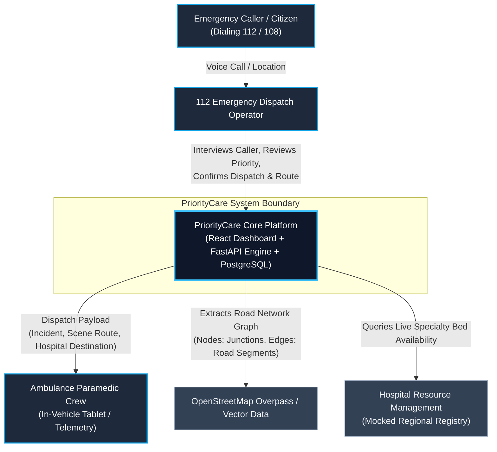
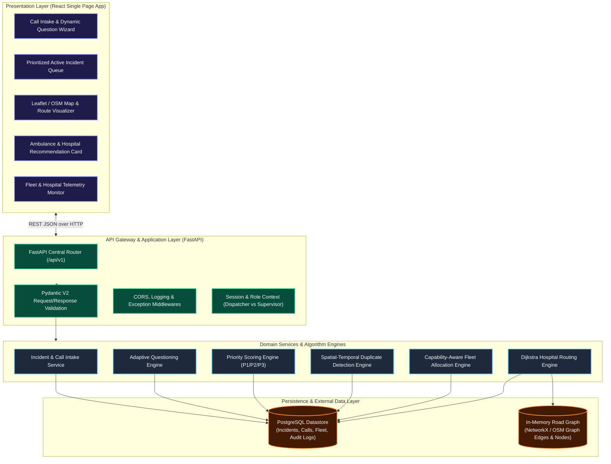
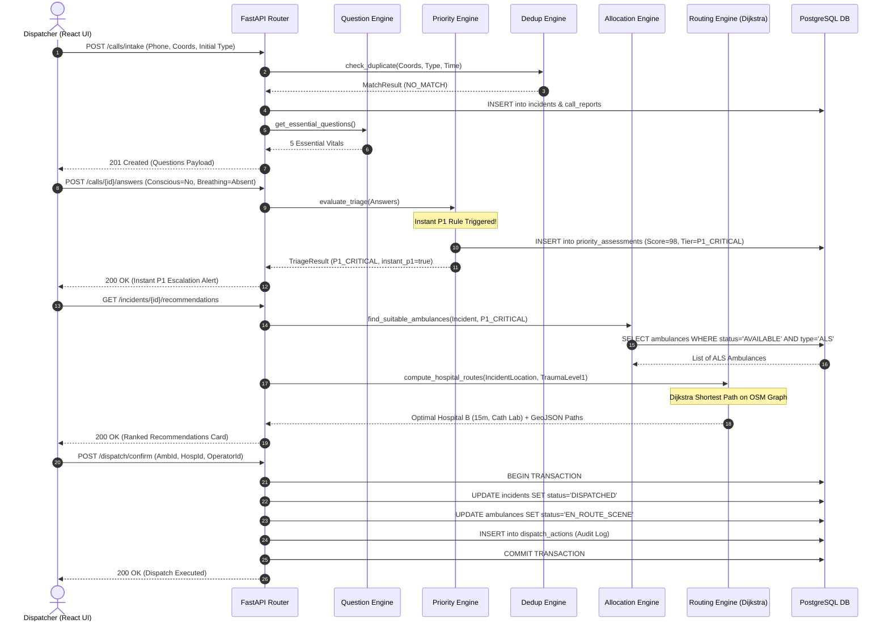
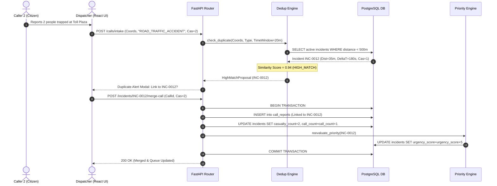
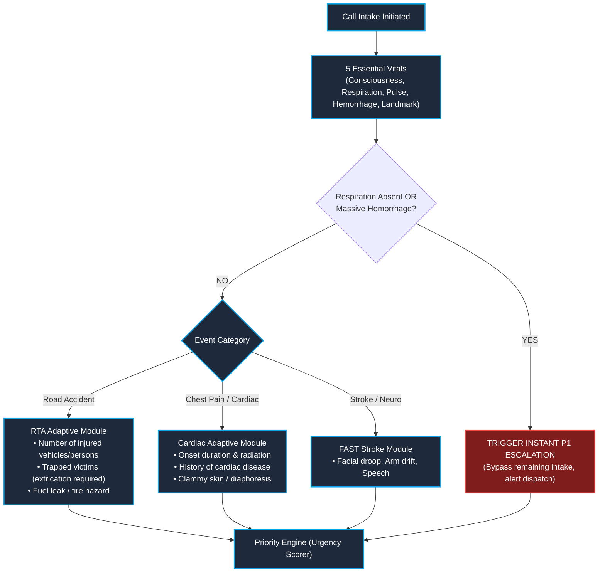
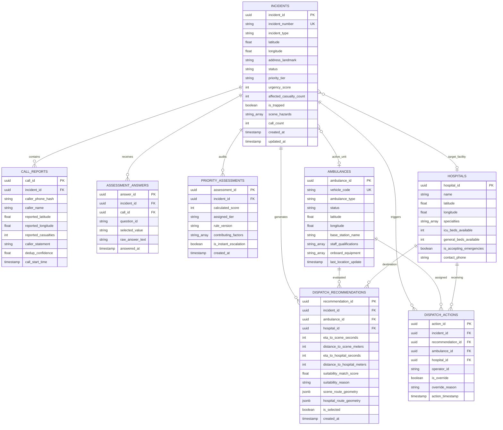

# PriorityCare (MEDI-DISPATCH AI) — End-to-End System Architecture

**Document Version:** 1.0.0-RELEASE  
**Document Status:** Approved Technical Architecture Baseline  
**Target Event:** INTELLATHON '26 (DSIRT × Dongguk University) | Team JARVIS  
**Primary Authors:** Senior Software Architect, Backend Architect & Technical Lead  
**Cross-Reference:** Accompanies [PRD.md](file:///c:/Users/PURUSOUTHANAN/OneDrive/Desktop/priorcare/PRD.md) and [MEDI-DISPATCH_AI_INTELLATHON-26.pptx](file:///c:/Users/PURUSOUTHANAN/OneDrive/Desktop/priorcare/MEDI-DISPATCH_AI_INTELLATHON-26.pptx)  

---

## 1. Executive Summary

PriorityCare is an intelligent emergency dispatch decision-support platform designed for control room call takers and dispatchers operating in national emergency environments (such as 112 ERSS and 108 Medical Emergency Response in India). 

The application is structured as a **modular monolith** combining a reactive Single Page Application (React) with an asynchronous API backend (Python FastAPI), a persistent relational and spatial datastore (PostgreSQL / PostGIS), and an embedded graph-theoretic routing engine (Dijkstra’s algorithm over OpenStreetMap road networks). 

The system transitions emergency operations from passive, manual, proximity-based dispatch into an **active, clinical-capability-aware copilot**. It eliminates sequential questionnaire delays with a fail-fast P1 triage protocol, deduplicates concurrent incoming calls without losing cumulative casualty counts, ranks ambulance units based on medical kit/crew suitability alongside travel time, and routes patients to hospitals that possess both the required specialty facilities (e.g., Trauma Level 1, Cardiac Cath Lab) and available bed capacity.

```
┌───────────────────────────────────────────────────────────────────────────────┐
│                           CORE ARCHITECTURAL PILLARS                          │
├───────────────────────┬───────────────────────────┬───────────────────────────┤
│ 1. Fail-Fast Triage   │ 2. Non-Destructive Dedup  │ 3. Capability-First Match │
│ • 5 Essential Vitals  │ • Spatial-temporal cluster│ • ALS/BLS kit matching    │
│ • Instant P1 (<10s)   │ • Accumulates casualties  │ • Dijkstra routing on OSM │
│ • Adaptive branches   │ • Prevents ghost incidents│ • Suitable hospital > near│
└───────────────────────┴───────────────────────────┴───────────────────────────┘
```

---

## 2. Architecture Goals and Design Principles

1. **Strict Decoupling of Medical Urgency from Dispatch Feasibility:** An incident's clinical priority ($P1, P2, P3$) is strictly derived from patient symptoms. A dying patient remains $P1$ even if the nearest ambulance is 45 minutes away. Dispatch feasibility is handled independently by the allocation engine.
2. **Human-in-the-Loop Supremacy:** In safety-critical emergency response, AI and algorithms propose; the human operator disposes. Every triage classification, vehicle assignment, and facility route is an advisory recommendation requiring operator review and confirmation.
3. **Deterministic & Explainable Scoring:** Black-box neural models are strictly excluded from automated triage decisions. Triage scoring is deterministic, auditable, and backed by a transparent checklist of contributing factors.
4. **Contract-First Modular Monolith:** To maximize hackathon development velocity across four team members, all internal services reside within a clean modular Python backend, governed by strict Pydantic data schemas. Microservices, distributed message queues, and Kubernetes are explicitly rejected for the MVP.
5. **Resilient Failure Modes & Graceful Degradation:** If external road data or network services become unavailable, the system automatically falls back to Euclidean distance estimates with heuristic velocity penalties, logging warnings without crashing the intake workflow.

---

## 3. Confirmed Requirements vs. Technical Assumptions

To maintain engineering integrity, all architectural choices are mapped against requirements from the team presentation and project context:

| Dimension | Confirmed from Presentation | Confirmed from PRD | Proposed Architectural Decision |
| :--- | :--- | :--- | :--- |
| **Frontend** | React dashboard (Slide 6) | React + Vite + TypeScript | Single Page App consuming REST API via Axios/Fetch |
| **Backend** | Flask mentioned in Slide 6 | FastAPI with Pydantic V2 | **FastAPI** adopted for automatic OpenAPI documentation, schema enforcement, and async performance |
| **Database** | PostgreSQL (Slide 6) | PostgreSQL with UUIDv4 | PostgreSQL with PostGIS extensions for spatial queries |
| **Triage Logic** | 5 essential questions; P1/P2/P3 (Slide 3) | Structured Question Bank | Deterministic rule-based scoring engine |
| **Duplicate Logic**| Distance + Time + Type matching (Slide 4) | 500m radius, 20m window | Spatial indexing with multi-attribute weighted confidence score |
| **Routing** | Dijkstra on OpenStreetMap (Slide 5) | Nodes = junctions, Edges = roads | NetworkX / OSM road graph loaded in-memory for the demo sector |
| **Traffic Data** | "Shortest-route dispatch" | Distance (m), Time (s) | **Simulated Synthetic Congestion Model** applying peak-hour multiplier to OSM speed limits |
| **CAD Feeds** | "Needs authorization before 108" | Mock simulation mode | Self-contained database seed with regional ambulances & hospitals |

---

## 4. System Context Diagram (C4 Level 1)

The System Context diagram illustrates the actors, PriorityCare system boundary, and external data interfaces:



---

## 5. High-Level Architecture Diagram (C4 Level 2)

The application architecture decomposes into presentation, application services, domain engines, and persistence layers:



---

## 6. Component Responsibilities and Team Ownership

The four teammates have distinct, non-overlapping ownership over the codebase while adhering to the common schema contracts:

```
┌─────────────────────────────────────────────────────────────────────────────┐
│                       TEAM OWNERSHIP & CODE BOUNDARIES                      │
├──────────────────┬─────────────────────────────┬────────────────────────────┤
│ Contributor      │ Subsystems Owned            │ Concrete Directory Targets │
├──────────────────┼─────────────────────────────┼────────────────────────────┤
│ **Person 1**     │ • Ambulance Allocation      │ `app/services/allocation/` │
│ *(AI, Product &  │ • Dijkstra Routing Engine   │ `app/services/routing/`    │
│ Architecture)*   │ • PostgreSQL / PostGIS DDL  │ `app/models/`, `db/`       │
│                  │ • PRD & System Architecture │ `PRD.md`, `ARCHITECTURE.md`│
├──────────────────┼─────────────────────────────┼────────────────────────────┤
│ **Person 2**     │ • 5 Essential Vitals Spec   │ `docs/TRIAGE_SPEC.md`      │
│ *(Research &     │ • Adaptive Branching Logic  │ `docs/QUESTION_BANK.json`  │
│ Decision Logic)* │ • P1/P2/P3 Urgency Rubrics  │ `tests/fixtures/scenarios/`│
├──────────────────┼─────────────────────────────┼────────────────────────────┤
│ **Person 3**     │ • Question Engine Service   │ `app/services/question/`   │
│ *(Backend &      │ • Priority Scoring Engine   │ `app/services/priority/`   │
│ Integration)*    │ • Duplicate Detector        │ `app/services/dedup/`      │
│                  │ • FastAPI Routes & Master   │ `app/api/v1/`, `main.py`   │
├──────────────────┼─────────────────────────────┼────────────────────────────┤
│ **Person 4**     │ • React Dispatcher Cockpit  │ `frontend/src/components/` │
│ *(UI/UX &        │ • Interactive OSM Map View  │ `frontend/src/views/`      │
│ Frontend)*       │ • Queue & Question Forms    │ `frontend/src/api/`        │
└──────────────────┴─────────────────────────────┴────────────────────────────┘
```

---

## 7. End-to-End Data Flow (12 Operational Scenarios)

The system handles twelve fundamental data flow scenarios:

1. **New Emergency Call Initiation:** Operator inputs caller phone, coordinates, and initial incident category. API creates a `CallReport` record and provisional `Incident` record with status `REPORTED`.
2. **Dynamic Question Serving:** Frontend requests screening questions. `QuestionEngine` delivers the 5 Essential Vitals (`Q_EVENT_TYPE`, `Q_CONSCIOUSNESS`, `Q_BREATHING`, `Q_BLEEDING`, `Q_LOCATION`).
3. **Instant P1 Fail-Fast Evaluation:** If `Q_BREATHING == ABSENT`, the `PriorityEngine` halts secondary questions, flags `is_instant_p1_triggered: true`, sets `priority_tier: P1_CRITICAL`, urgency score to 98, and alerts the operator within $<10$ seconds.
4. **Adaptive Secondary Questioning:** If patient is stable, the `QuestionEngine` selects branching modules (e.g., Road Accident entrapment & casualties vs. Cardiac onset time).
5. **Spatial-Temporal Duplicate Clustering:** When an intake call is created, `DedupEngine` queries active incidents within a 500m radius and 20-minute time window. Matching incident types and landmarks produce a similarity score $(0.00 - 1.00)$.
6. **Non-Destructive Call Merging:** A high-confidence duplicate links the new `CallReport` to the existing `Incident`. Casualty count updates cumulatively ($\max(\text{reported}, \text{current})$), hazards are appended, and the incident priority is re-scored.
7. **Dynamic Queue Re-sorting:** Active incidents are fetched with SQL ordering: `priority_tier ASC` (P1 > P2 > P3), `urgency_score DESC`, and `created_at ASC`. Incoming P1 incidents immediately jump to index 0 of the dispatcher's queue.
8. **Candidate Ambulance Allocation:** `AllocationEngine` filters active fleet for status `AVAILABLE`, matches clinical requirement against vehicle capability (`ALS` required for P1, `BLS` for P2), computes network ETA, and ranks candidates.
9. **Dijkstra Hospital Routing with Capability Filtering:** `RoutingEngine` queries hospitals equipped with necessary specialties (Trauma Level 1, Cardiac Cath Lab) and open ICU beds. It computes the minimum travel-time path across the OSM road graph using Dijkstra's algorithm.
10. **Operator Review & Confirmation:** The React UI presents the top recommendation card showing ambulance ETA, receiving hospital, capability rationale, and map paths. The operator clicks "Confirm Dispatch" (or specifies an override reason).
11. **State Machine Execution:** The confirmed dispatch triggers a database transaction: Incident status $\to$ `DISPATCHED`, Ambulance status $\to$ `EN_ROUTE_SCENE`, and a persistent immutable audit record is saved in `dispatch_actions`.
12. **Exception Handling & Vehicle Preemption:** If a recommended ambulance becomes unavailable before confirmation, the allocation engine re-evaluates the candidate pool and shifts recommendation to the second-ranked unit without terminating the intake flow.

---

## 8. Mermaid Sequence Diagrams for Critical Workflows

### 8.1 Workflow 1: Call Intake, Fail-Fast Triage & Dispatch Confirmation



---

### 8.2 Workflow 2: Multi-Call Duplicate Detection & Non-Destructive Merge



---

## 9. Dynamic Question & Priority Engine Integration

### 9.1 The Question Selection Decision Tree
The dynamic intake engine is managed as a directed acyclic decision graph loaded from `docs/QUESTION_BANK.json`:



### 9.2 The Priority Scoring Formula
Urgency is computed as an integer score $(0 - 100)$:
$$\text{UrgencyScore} = \min\left(100, \, B_{\text{category}} + \sum w_i \cdot \text{AnswerValue}_i + M_{\text{casualties}} + H_{\text{hazards}}\right)$$

Where:
* $B_{\text{category}}$ is baseline emergency weight (e.g., Cardiac = 40, RTA = 30, Minor Fall = 10).
* $w_i \cdot \text{AnswerValue}_i$ are clinical symptom coefficients (e.g., Unresponsive = +35, Gasping = +50, Trapped Casualty = +25).
* $M_{\text{casualties}}$ adds $+10$ points for multiple casualties ($>1$).
* $H_{\text{hazards}}$ adds $+15$ points for scene fire or hazardous chemical spill.

**Tiers:**
* **$P1$ (Score 80–100):** Immediate life threat. Lights & sirens dispatch.
* **$P2$ (Score 45–79):** High urgency. Urgent dispatch within standard response targets.
* **$P3$ (Score 0–44):** Lower urgency / stable medical transport.

---

## 10. Ambulance Recommendation & Routing Integration

### 10.1 Allocation Matching Metric
Ambulances are evaluated against an incident requirement tuple $\langle \text{UrgencyTier}, \text{IncidentType}, \text{Casualties} \rangle$:

1. **Hard Constraint Filter:**
   $$\text{EligibleUnits} = \{ a \in \text{Ambulances} \mid a.\text{status} = \text{'AVAILABLE'} \land \text{IsCapable}(a, \text{UrgencyTier}) \}$$
   *(If $P1$, only ALS units with active defibrillator and ventilator are eligible. If zero ALS units are available, BLS units are admitted with an explicit downgrade alert).*
2. **Scoring & Ranking Function:**
   $$\text{MatchScore}(a) = \left(1.0 - \frac{\text{ETA}(a)}{\text{MaxAcceptableETA}}\right) \times 0.60 + \text{KitScore}(a) \times 0.25 + \text{CrewExp}(a) \times 0.15$$

### 10.2 Dijkstra Hospital Routing over OpenStreetMap
The road network is modeled as a weighted directed graph $G = (V, E)$, where $V$ represents intersections and facility gates, and $E$ represents directed road links.

* **Edge Weight Calculation:**
  $$\text{Weight}(u, v) = \frac{\text{LengthMeters}(u, v)}{\text{SpeedLimitKmh}(u, v) \times \text{TrafficMultiplier}} \times 3.6$$
* **Synthetic Congestion Model:**  
  Since commercial live traffic APIs are inaccessible during the hackathon, a deterministic **Synthetic Congestion Engine** modulates weights based on time-of-day and road classification (e.g., peak hours 08:30–10:30 and 17:30–19:30 apply a $1.4\times$ travel duration penalty on arterial roads).
* **Suitability-First Pruning:**  
  Before executing Dijkstra's algorithm, the destination set is restricted to hospitals satisfying:
  $$\text{EligibleHospitals} = \{ h \in \text{Hospitals} \mid h.\text{accepting} = \text{True} \land h.\text{icu\_beds} > 0 \land \text{MatchesSpecialty}(h, \text{IncidentType}) \}$$
  Dijkstra's algorithm is then run to find $\min_{h \in \text{EligibleHospitals}} \text{TravelTime}(\text{IncidentLoc}, h)$.

---

## 11. Database Entity-Relationship Diagram

The complete PostgreSQL relational model reflects the shared data contract established in [PRD.md](file:///c:/Users/PRD.md):



---

## 12. Data Ownership and Persistence Boundaries

| Domain Component | Authoritative Table | Secondary / Read-Only Views | Mutation Rules |
| :--- | :--- | :--- | :--- |
| **Incident Intake** | `incidents`, `call_reports` | Dispatcher queue cards, map markers | Only mutated by `IncidentService` via authenticated intake routes. |
| **Triage Engine** | `assessment_answers`, `priority_assessments` | Incident priority badges | Append-only historical snapshots; never updated in-place. |
| **Fleet Tracking** | `ambulances` | Allocation candidate selector, map layer | State changed only upon confirmed dispatch, scene arrival, or depot return. |
| **Hospital Registry**| `hospitals` | Routing engine filter | Updated by hospital resource mock feed or operator override. |
| **Audit Ledger** | `dispatch_actions` | Supervisor historical audit logs | Strictly append-only. Zero deletion or updating allowed. |

---

## 13. REST API Boundaries

All API routes are prefixed with `/api/v1` and structured around operational dispatcher workflows:

```
/api/v1/
├── calls/
│   ├── POST /intake                  # Initiate call, check dedup, return 5 vitals
│   └── POST /{call_id}/answers       # Submit answers, evaluate instant P1, return next questions
├── incidents/
│   ├── GET  /                        # Fetch prioritized active queue (?status=ACTIVE)
│   ├── GET  /{id}                    # Retrieve full incident dossier
│   ├── POST /check-duplicate         # Standalone spatial-temporal dedup analysis
│   ├── POST /{id}/merge-call         # Link duplicate call and aggregate casualty count
│   └── GET  /{id}/recommendations    # Retrieve top 3 ambulance + hospital routes
├── dispatch/
│   ├── POST /confirm                 # Operator confirms recommended dispatch
│   └── POST /override                # Operator overrides with reason code
├── fleet/
│   ├── GET  /ambulances              # List all ambulances with GPS & status
│   └── PATCH/ambulances/{id}/status  # Update vehicle status (Available, Busy, At Scene)
└── hospitals/
    └── GET  /                        # List regional hospitals, bed counts & specialties
```

---

## 14. Security, Privacy, and Audit Design

1. **Caller Privacy & Data Minimization:**  
   Citizen phone numbers are never stored in raw plaintext. Numbers are hashed using SHA-256 with a daily rotating salt (`caller_phone_hash = SHA256(phone + salt)`). Only the last 4 digits are presented in the UI for verification (`***-***-3210`).
2. **Defensive Input Validation:**  
   All incoming parameters are validated at the API boundary using Pydantic V2. Latitude and longitude must fall within valid geographic bounds ($[-90, 90]$ and $[-180, 180]$), and string inputs are sanitized against SQL and XSS injection.
3. **Immutable Dispatch Audit Ledger:**  
   Every assignment and override writes an immutable record to `dispatch_actions` recording the timestamp, operator badge number, selected vehicle, and explicit override rationale.
4. **Role Context in Prototype:**  
   For the hackathon demonstration, request headers supply operator identity (`X-Operator-ID: DISPATCHER_01`). Production implementations will exchange this for OAuth2 / JWT authentication backed by state police/health authority directories.

---

## 15. Failure Handling and Fallback Strategies

| Failure Mode | Detection Mechanism | Immediate Fallback Behavior |
| :--- | :--- | :--- |
| **OSM Road Graph Unreachable** | Routing service catch-block on graph query | System falls back to **Haversine Euclidean distance** with a $1.3\times$ urban detour penalty and estimated 35 km/h transit velocity. Flagged as `ESTIMATED_ROUTE`. |
| **Zero Available ALS Ambulances** | Allocation engine filter returns empty set | System admits nearest **BLS ambulance** for immediate on-scene CPR/stabilization, raises a high-priority `BLS_DOWNGRADE_ALERT` banner, and suggests staging an ALS unit from an adjacent sector. |
| **Ambiguous Duplicate Call** | Match confidence between 50% and 85% | Engine refuses auto-merge and presents an **Operator Adjudication Modal** comparing caller statements, allowing the human dispatcher to confirm or split incidents. |
| **Database Transaction Deadlock** | SQLAlchemy concurrency exception | Transaction rolls back automatically and retries twice with exponential backoff before surfacing an error to the UI. |

---

## 16. Deployment and Runtime Architecture

The entire stack is packaged for local and staging deployment via Docker Compose:

```
┌─────────────────────────────────────────────────────────────┐
│                 DOCKER COMPOSE RUNTIME                      │
├─────────────────────────────────────────────────────────────┤
│  Container 1: frontend-ui                                   │
│  • React 18 + Vite Production Build served via Nginx        │
│  • Port: 80 / 3000                                          │
├─────────────────────────────────────────────────────────────┤
│  Container 2: backend-api                                   │
│  • Python 3.12 + FastAPI + Uvicorn Async Server            │
│  • Port: 8000                                               │
├─────────────────────────────────────────────────────────────┤
│  Container 3: postgres-db                                   │
│  • PostgreSQL 16 + PostGIS Extension                        │
│  • Persistent Volume: postgres_data                         │
│  • Port: 5432                                               │
└─────────────────────────────────────────────────────────────┘
```

---

## 17. Repository Structure and Team Ownership

```
prioritycare/
├── app/                              # FastAPI Backend (Person 1, 2, 3)
│   ├── api/                          # REST Route Controllers
│   │   ├── deps.py                   # Database & session dependencies
│   │   └── v1/                       # API Version 1 Routers
│   │       ├── calls.py              # Call intake & screening routes (Person 3)
│   │       ├── incidents.py          # Incident queue & dossiers (Person 3)
│   │       ├── dispatch.py           # Dispatch execution & audit (Person 1 & 3)
│   │       └── telemetry.py          # Fleet & hospital queries (Person 1)
│   ├── core/                         # Config & base utilities
│   │   ├── config.py                 # Pydantic BaseSettings (.env loader)
│   │   └── exceptions.py             # Custom operational exceptions
│   ├── models/                       # SQLAlchemy Database ORM Models (Person 1)
│   │   ├── incident.py
│   │   ├── ambulance.py
│   │   ├── hospital.py
│   │   └── audit.py
│   ├── schemas/                      # Pydantic V2 Contract Schemas (SHARED CONTRACT)
│   │   ├── domain.py                 # Core domain entities & enums
│   │   └── api_payloads.py           # Request & Response body definitions
│   └── services/                     # Core Business Logic & Engines
│       ├── question_engine.py        # Dynamic question selection (Person 3)
│       ├── priority_engine.py        # Urgency scoring & P1/P2/P3 rules (Person 3)
│       ├── dedup_engine.py           # Spatial-temporal call clustering (Person 3)
│       ├── allocation_engine.py      # Fleet suitability & candidate ranking (Person 1)
│       └── routing_engine.py         # Dijkstra shortest-path on OSM graph (Person 1)
├── db/                               # Database migrations & seed scripts (Person 1)
│   ├── init.sql                      # DDL schema definition
│   └── seed_demo_data.py             # Preloads demo ambulances, hospitals & road graph
├── docs/                             # Research & Decision Specifications (Person 2)
│   ├── TRIAGE_SPEC.md                # Clinical scoring formulas & vital signs rubrics
│   └── QUESTION_BANK.json            # Dynamic decision tree & question bank
├── frontend/                         # React UI Dashboard (Person 4)
│   ├── src/
│   │   ├── api/client.ts             # Axios/Fetch client against FastAPI
│   │   ├── components/
│   │   │   ├── CallIntakeModal.tsx   # Dynamic question wizard
│   │   │   ├── IncidentQueue.tsx     # Prioritized live table view
│   │   │   ├── MapView.tsx           # Leaflet / OSM road route visualization
│   │   │   └── RecommendationCard.tsx# Ambulance & hospital proposal cards
│   │   └── App.tsx                   # Main 3-pane dashboard shell
│   ├── package.json
│   └── vite.config.ts
├── PRD.md                            # Product Requirements Document (Person 1)
├── SYSTEM_ARCHITECTURE.md            # Complete System Architecture (This File)
├── docker-compose.yml                # Multi-container orchestration (Person 1 & 3)
└── README.md                         # Setup & Demonstration Guide
```

---

## 18. GitHub Integration & Parallel Development Strategy

To eliminate merge conflicts and maintain contract integrity across all four team members:

```
               [ master ] (Protected: Maintained by Person 3)
                   │
    ┌──────────────┼──────────────┬──────────────┐
    ▼              ▼              ▼              ▼
feature/       feature/       feature/       feature/
ai-allocation- triage-rules   backend-core   react-dashboard
routing        (Person 2)     (Person 3)     (Person 4)
(Person 1)
```

1. **Schema Freeze:** `app/schemas/domain.py` and `PRD.md` are **strictly frozen**. No contributor may rename fields or alter types without a team meeting.
2. **Frontend Mocking Strategy:** Person 4 (UI/UX) can develop against static JSON fixtures or a lightweight mock endpoint in FastAPI immediately without waiting for routing or triage algorithm completion.
3. **Pull Request Rules:** Every pull request requires:
   * Passing Pydantic validation tests.
   * Zero linting or schema drift errors.
   * Approval from Person 3 (Master Integration Owner).

---

## 19. Testing Strategy

* **Unit Testing (Pytest):**  
  Dedicated automated test suites verify that `priority_engine.py` correctly triggers instant P1 escalation on absent breathing, `dedup_engine.py` clusters duplicate calls within 500m, and `routing_engine.py` correctly calculates Dijkstra shortest paths.
* **Contract Verification Tests:**  
  FastAPI’s automatic OpenAPI generator is validated against TypeScript types using schema verification scripts.
* **End-to-End Scenario Testing:**  
  Automated tests simulate the 4 acceptance scenarios specified in PRD Section 9 before final demonstration.

---

## 20. MVP vs. Future Production Architecture

| Capability | Hackathon MVP Architecture | Future Production Architecture (112/108) |
| :--- | :--- | :--- |
| **Road Network** | In-memory NetworkX graph of demo district | Distributed OSRM / Valhalla server cluster |
| **Traffic Data** | Synthetic time-of-day congestion multipliers | Live telematics, camera sensors & TomTom/Google API feeds |
| **Ambulance GPS** | Seeded fleet database with manual/simulated updates | In-vehicle AIS-140 GPS telematics hardware streams |
| **Authentication**| Mock operator context header (`X-Operator-ID`) | OAuth2 / OIDC with Government SSO & biometric 2FA |
| **Clinical Triage**| Deterministic prototype decision tree | Formally certified clinical decision protocols (e.g., MPDS) |
| **High Availability**| Single-node Docker Compose instance | Multi-region Kubernetes cluster with active-active DB failover |

---

## 21. Architectural Decisions, Open Questions, and Risks

### 21.1 Confirmed Architectural Decisions (ADRs)
* **ADR-001 (FastAPI adoption):** Replaced slide mention of Flask with FastAPI to obtain automatic OpenAPI contract generation, async capability, and robust Pydantic data validation.
* **ADR-002 (In-Memory OSM Routing):** Loaded regional OSM road network directly into an in-memory graph (NetworkX) to deliver $<50\text{ms}$ Dijkstra route calculations without external API costs or internet latency.
* **ADR-003 (Cumulative Casualty Invariant):** Enforced that duplicate call merges must take the maximum of reported casualties to prevent casualty count dilution during mass-casualty incidents.

### 21.2 Open Questions for Final Review
1. **Demo Geographic Bounding Box:** Bounding coordinates for Perambalur / Trichy district, Tamil Nadu (DSIRT location) will be used as default road network boundaries unless the team selects another test city.
2. **Traffic Simulation Interval:** How frequently should synthetic traffic multipliers modulate (e.g., static peak hours vs. dynamic event-driven congestion)?

---

### End of System Architecture Document
*Approved for implementation by Senior System Architect & Technical Lead.*
