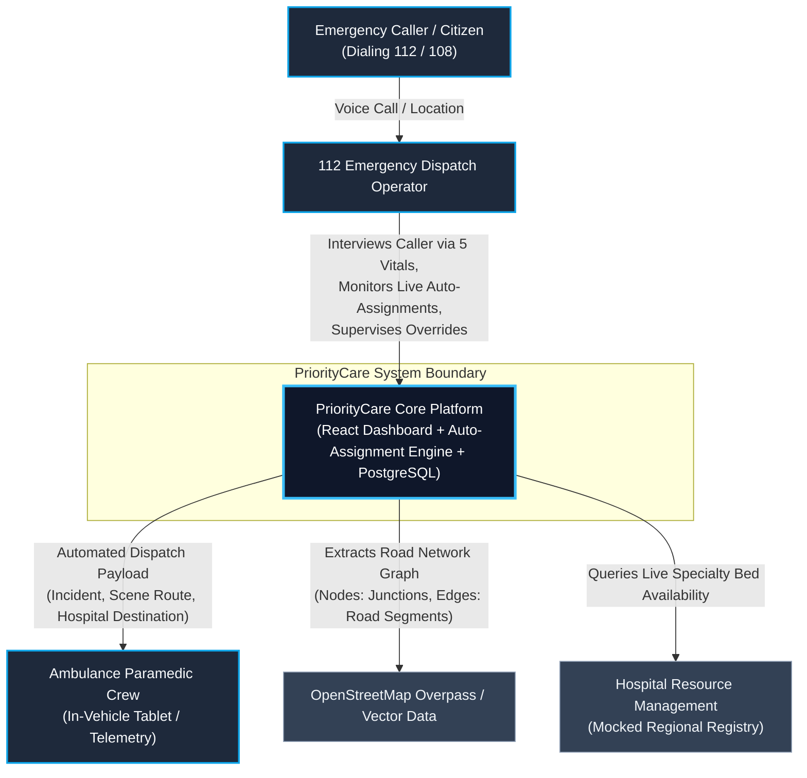
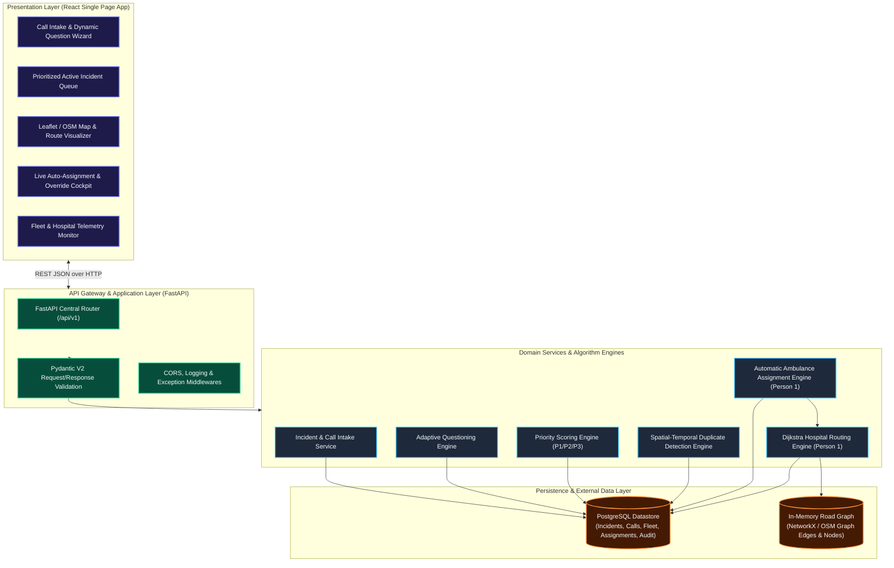
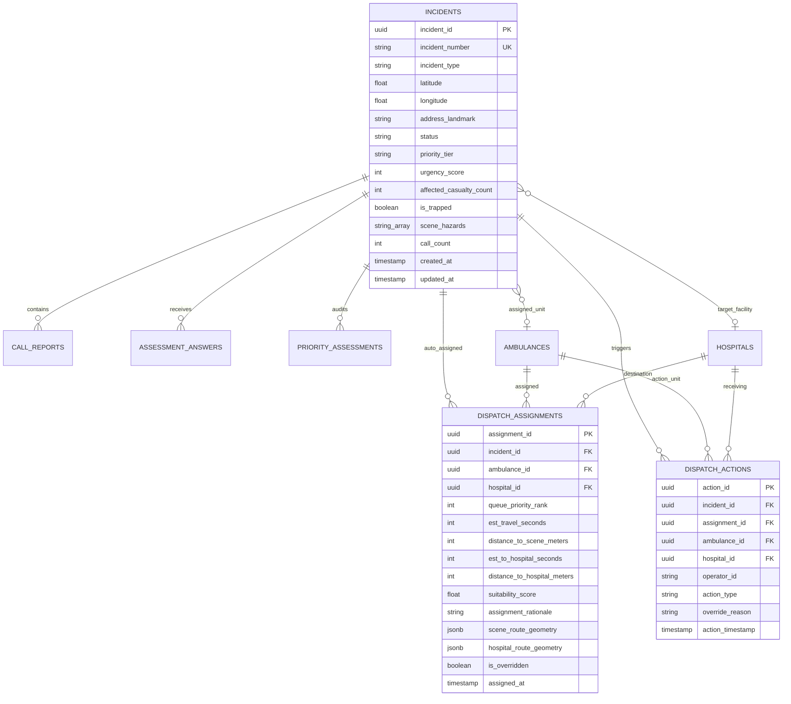

# PriorityCare (MEDI-DISPATCH AI) — End-to-End System Architecture

**Document Version:** 1.1.0-RELEASE (Automatic Assignment Update)  
**Document Status:** Approved Technical Architecture Baseline  
**Target Event:** INTELLATHON '26 (DSIRT × Dongguk University) | Team JARVIS  
**Primary Authors:** Senior Software Architect, Backend Architect & Technical Lead (Person 1)  
**Cross-Reference:** Accompanies [PRD.md](file:///c:/Users/PURUSOUTHANAN/OneDrive/Desktop/priorcare/PRD.md) and [Priority-108(PPT).pptx](file:///c:/Users/PURUSOUTHANAN/OneDrive/Desktop/priorcare/Priority-108(PPT).pptx)  

---

## 1. Executive Summary

PriorityCare is an automated emergency dispatch and triage platform designed for control room call takers and dispatchers operating in national emergency environments (such as 112 ERSS and 108 Medical Emergency Response in India). 

The platform is engineered as a **modular monolith** combining a reactive Single Page Application (React) with an asynchronous API backend (Python FastAPI), a persistent relational and spatial datastore (PostgreSQL / PostGIS), and an embedded graph-theoretic routing engine (Dijkstra’s algorithm over OpenStreetMap road networks). 

The system transitions emergency operations from slow, manual, proximity-based dispatch into an **automated, capability-aware copilot**. Instead of forcing an operator to manually browse map pins and pick an ambulance, PriorityCare uses an **Automatic Ambulance Assignment Engine**:
1. It continuously monitors the **Dynamic Priority Queue** ($P1\_CRITICAL > P2\_HIGH\_URGENCY > P3\_LOWER\_URGENCY$).
2. The most critical incident queues are evaluated first for immediate unit assignment.
3. The engine automatically matches and assigns the optimal available ambulance based on **Operational Availability** (`AVAILABLE`), **Clinical Suitability** (`ALS` for P1 trauma/cardiac; `BLS` for P2), and **Estimated Travel Time (EST / ETA)** calculated via Dijkstra’s shortest-path algorithm over the road network graph.
4. The assigned unit and optimal hospital route are instantly dispatched, while the operator retains **supervisory override authority** to reassign or cancel if field conditions demand.

```
┌───────────────────────────────────────────────────────────────────────────────┐
│                           CORE ARCHITECTURAL PILLARS                          │
├───────────────────────┬───────────────────────────┬───────────────────────────┤
│ 1. Fail-Fast Triage   │ 2. Non-Destructive Dedup  │ 3. Automated Assignment   │
│ • 5 Essential Vitals  │ • Spatial-temporal cluster│ • Evaluates queue urgency │
│ • Instant P1 (<10s)   │ • Accumulates casualties  │ • Matches ALS/BLS kit     │
│ • Adaptive branches   │ • Prevents ghost incidents│ • Auto-assigns by EST/ETA │
└───────────────────────┴───────────────────────────┴───────────────────────────┘
```

---

## 2. Architecture Goals and Design Principles

1. **Automatic Assignment for Urgent Queues:** The system automatically pairs the most critical incidents at the top of the queue with the closest suitable available ambulance. Operators do not need to manually browse lists or calculate ETAs during peak crisis moments.
2. **Strict Decoupling of Medical Urgency from Dispatch Feasibility:** An incident's clinical priority ($P1, P2, P3$) is strictly derived from patient symptoms. A dying patient remains $P1$ even if the nearest ambulance is 30 minutes away.
3. **Supervisory Human-in-the-Loop Authority:** The system automatically executes the optimal assignment to minimize latency, but the operator dashboard provides full transparency and immediate **Manual Override / Reassignment** controls with mandatory audit logging.
4. **Deterministic & Explainable Assignment:** Every auto-assignment generates a transparent rationale (e.g., *"Auto-Assigned: Nearest ALS unit (EST: 8m) matched for top-priority P1 Cardiac arrest; Hospital B matched for Cath Lab"*).
5. **Contract-First Modular Monolith:** All components run within a unified FastAPI backend with strict Pydantic models. Microservices and distributed message queues are excluded to ensure zero integration latency.

---

## 3. System Context Diagram (C4 Level 1)



---

## 4. High-Level Architecture Diagram (C4 Level 2)



---

## 5. End-to-End Workflow with Automated Assignment

```mermaid
sequenceDiagram
    autonumber
    actor Caller as Emergency Caller
    actor Dispatcher as Dispatcher (React UI)
    participant API as FastAPI Router
    participant QE as Question Engine
    participant PE as Priority Engine
    participant AAE as Auto-Assignment Engine (Person 1)
    participant RE as Routing Engine (Dijkstra)
    participant DB as PostgreSQL DB

    Caller->>Dispatcher: Reports collision / unconscious patient
    Dispatcher->>API: POST /calls/intake (Phone, Coords, Initial Type)
    API->>DB: INSERT into incidents & call_reports
    API->>QE: get_essential_questions()
    QE-->>Dispatcher: 5 Essential Screening Questions

    Dispatcher->>API: POST /calls/{id}/answers (Conscious=No, Breathing=Absent)
    API->>PE: evaluate_triage(Answers)
    Note over PE: Instant P1 Rule Triggered (Score=98, Tier=P1_CRITICAL)
    PE->>DB: INSERT into priority_assessments
    PE-->>API: TriageResult (P1_CRITICAL, instant_p1=true)

    Note over API,AAE: AUTOMATIC ASSIGNMENT TRIGGERED IMMEDIATELY
    API->>AAE: auto_assign_top_queue(IncidentId)
    AAE->>DB: SELECT available ambulances WHERE status='AVAILABLE' AND type='ALS'
    DB-->>AAE: Available ALS Units
    AAE->>RE: compute_shortest_est_and_hospital(IncidentCoords, TraumaLevel1)
    Note over RE: Dijkstra Shortest Path on OSM Road Graph
    RE-->>AAE: Optimal Unit AMB-ALS-02 (EST: 480s) + Hospital B (Trauma Level 1)
    
    AAE->>DB: BEGIN TRANSACTION
    AAE->>DB: INSERT into dispatch_assignments (EST=480s, Unit=AMB-ALS-02)
    AAE->>DB: UPDATE incidents SET status='AUTO_ASSIGNED', active_ambulance_id='AMB-ALS-02'
    AAE->>DB: UPDATE ambulances SET status='ASSIGNED'
    AAE->>DB: COMMIT TRANSACTION

    API-->>Dispatcher: 200 OK (Instant P1 & Ambulance Auto-Assigned Alert)
    Note over Dispatcher: Operator monitors auto-dispatch; can trigger manual override if needed
```

---

## 6. Automatic Queue-to-Fleet Assignment Logic (Person 1)

The Automatic Ambulance Assignment Engine continuously evaluates unassigned incidents in the priority queue:

### 6.1 Queue Ordering Invariant
Incidents are ordered strictly by:
$$\text{PriorityRank} = \langle \text{Tier} \,(P1 > P2 > P3), \, \text{UrgencyScore} \, (\text{desc}), \, \text{CreatedAt} \, (\text{asc}) \rangle$$

The engine processes incidents starting at Rank 1 (highest urgency).

### 6.2 Unit Matching & EST Optimization
For each incident $I$, the candidate ambulance set is filtered:
$$\text{Candidates}(I) = \{ a \in \text{Ambulances} \mid a.\text{status} = \text{'AVAILABLE'} \land \text{IsCapable}(a, I.\text{priority\_tier}) \}$$

* If $I.\text{priority\_tier} = P1$, capability requires an **ALS** unit with ventilator and defibrillator.
* For each eligible candidate $a$, the engine computes:
  $$\text{EST}(a, I) = \text{DijkstraTravelTime}(\text{Location}(a), \text{Location}(I))$$
* **Auto-Assignment Execution:**
  The unit with minimum travel time $\arg\min_{a \in \text{Candidates}(I)} \text{EST}(a, I)$ is **automatically assigned** to $I$.
* If no capable units are available, the incident is flagged with `status = PENDING_ASSIGNMENT`, and the moment an ALS unit completes a hospital handover and enters `AVAILABLE` status, the engine instantly assigns it.

---

## 7. Database Entity-Relationship Diagram



---

## 8. REST API Boundaries

```
/api/v1/
├── calls/
│   ├── POST /intake                  # Initiate call, check dedup, return 5 vitals
│   └── POST /{call_id}/answers       # Submit answers, evaluate P1, auto-trigger assignment
├── incidents/
│   ├── GET  /                        # Fetch prioritized active queue (?status=ACTIVE)
│   ├── GET  /{id}                    # Retrieve full incident dossier
│   ├── POST /check-duplicate         # Spatial-temporal dedup analysis
│   ├── POST /{id}/merge-call         # Link duplicate call & aggregate casualties
│   └── GET  /{id}/assignment         # Retrieve active automated assignment & live EST
├── dispatch/
│   ├── POST /auto-assign             # Manually or event-triggered queue auto-assignment
│   └── POST /override                # Operator supervisory override & manual reassignment
├── fleet/
│   ├── GET  /ambulances              # List all ambulances with GPS & status
│   └── PATCH/ambulances/{id}/status  # Update vehicle status (Available, Assigned, etc.)
└── hospitals/
    └── GET  /                        # List hospitals, bed counts & specialties
```

---

### Architecture Baseline Status
*Updated to reflect Automatic Ambulance Assignment by EST, Location Availability, and Priority Queue Ranking (Person 1).*
